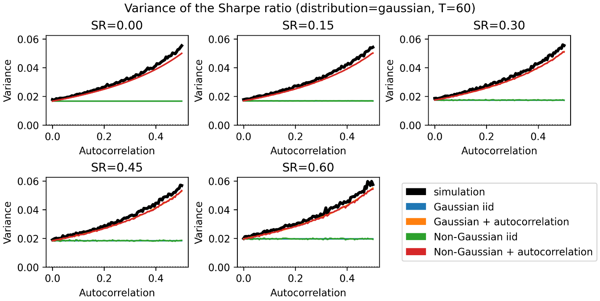
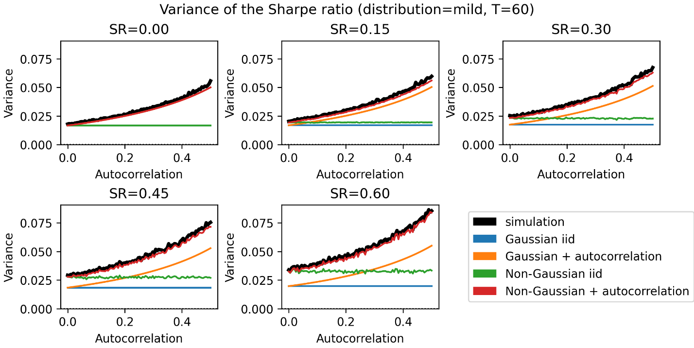
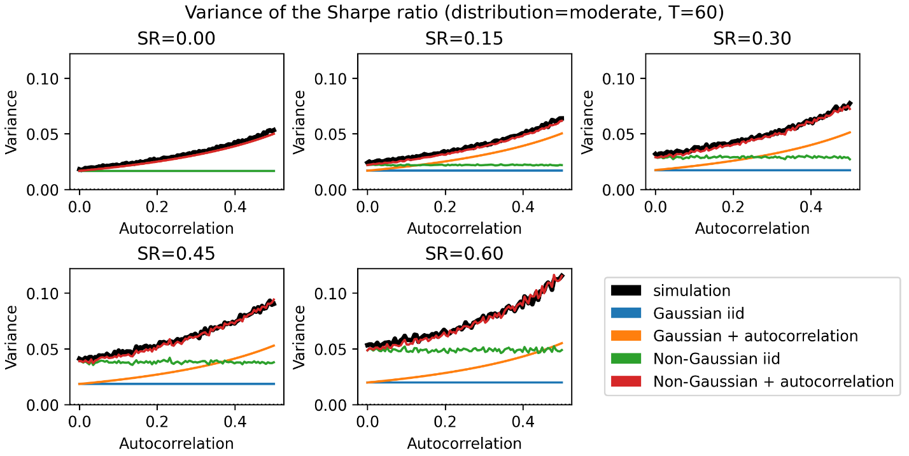
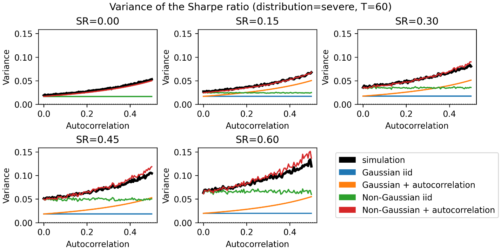

# How to Use the Sharpe Ratio

**Authors**: Marcos López de Prado, Alexander Lipton, and Vincent Zoonekynd

**Source**: ADIA Lab Research Paper Series, No. 19 · March 7, 2026

**Replication code**: <https://github.com/zoonek/2025-sharpe-ratio>

> **Source PDF**: [lopez-de-prado-sharpe-2026.pdf](./lopez-de-prado-sharpe-2026.pdf) ·
> **Numba JIT**: [sharpe_numba.py](./sharpe_numba.py) ·
> **Equation Tracker**: [sharpe-paper-tracker.md](./sharpe-paper-tracker.md)

---

## Scope of this excerpt

This file transcribes only the parts of the paper that this skill implements: the generalized (non-Normal, AR(1)) sampling variance of the Sharpe ratio, the Probabilistic Sharpe Ratio (PSR), the Minimum Track Record Length (MinTRL), the critical Sharpe ratio and the power of the test, with the Appendix A.1–A.2 derivations. The paper's sections on Bayesian false discovery rates, multiple-testing / trial-count corrections, the Deflated Sharpe Ratio and the sequential FDR threshold, and Appendices A.3–A.6, are deliberately omitted under the operator rule of 2026-10-15 (see the skill's SKILL.md § "Out of scope"). The source PDF remains the complete record. Equation numbers below are the paper's own.

---

## Introduction (excerpt)

A central principle of modern portfolio theory is that investors are willing to bear risk only to the extent that they expect to be compensated for it. Investment efficiency is commonly defined as the amount of return achieved per unit of risk. The most widely accepted measure is the Sharpe ratio, which expresses excess return relative to volatility (Sharpe [1966, 1975, 1994]).

The pitfalls this excerpt addresses:

1. **No statistical significance**: A point estimate of the Sharpe ratio does not convey information about its statistical significance.
2. **Biased inference**: Sharpe ratio inference is biased by sample length, skewness, kurtosis and serial correlation.
3. **Unreported power**: Practitioners and academics almost never report the power of the test, concealing potentially high type-II error.

---

## Literature Review (excerpt)

In a landmark paper, Lo [2002] derived an asymptotic framework for Sharpe ratio inference under i.i.d. Normal returns. For the more realistic case of serial dependence and non-Normality, he formulated the problem in HAC/GMM form but did not provide an explicit closed-form approximation to the sampling distribution.

Bailey and López de Prado [2012] introduced: (i) the probabilistic Sharpe ratio (PSR); (ii) the minimum track record length (MinTRL); and (iii) the concept of the Sharpe ratio efficient frontier.

---

## Innovation used here

**Closed-form sampling distribution** of the Sharpe ratio under non-Normal, serially correlated returns via the functional delta method applied to an M-estimator with HAC long-run covariance.

---

## The Sharpe Ratio

Consider a sample of $T$ excess returns $\lbrace r_t\rbrace_{t=1,\ldots,T}$ from a stationary process with finite population mean $\mu$ and variance $\sigma^2$. The true (unobserved) Sharpe ratio is

$$SR = \frac{\mu}{\sigma} \tag{1}$$

The Sharpe ratio satisfies several important properties: (i) the tangency portfolio in Markowitz's efficient frontier has maximum Sharpe ratio; (ii) its definition only requires the first two moments to exist and be finite; (iii) under linear and sufficiently low funding costs, it is approximately scale-free within a given sampling frequency.

---

## Generalized Sampling Distribution of the Sharpe Ratio

Hedge fund strategy returns are characterized by short sample lengths, positive Sharpe ratio, positive serial correlation, negative skewness, and positive excess kurtosis—five features that increase the sampling variance of the Sharpe ratio estimator.

**Exhibit 1 – Non-Normality and serial-correlation in hedge fund returns (monthly frequency)**

| HFR Indices      | Composite     | Equity Hedge  | Event-Driven  | Relative Value | Macro        |
| ---------------- | ------------- | ------------- | ------------- | -------------- | ------------ |
| **BBG Code**     | HFRIFWI Index | HFRIEHI Index | HFRIEDI Index | HFRIRVA Index  | HFRIMI Index |
| **Mean**         | 0.007         | 0.009         | 0.008         | 0.007          | 0.007        |
| **StDev**        | 0.019         | 0.026         | 0.020         | 0.012          | 0.020        |
| **Skew**         | −0.711        | −0.319        | −1.425        | −2.703         | 0.694        |
| **Kurt**         | 6.381         | 5.303         | 9.889         | 22.897         | 4.611        |
| **AR(1)**        | 0.249         | 0.191         | 0.300         | 0.365          | 0.176        |
| **T**            | 431           | 431           | 431           | 431            | 431          |
| **JB (stat)**    | 234.920       | 99.130        | 974.210       | 7457.520       | 79.160       |
| **JB (p)**       | 0.000         | 0.000         | 0.000         | 0.000          | 0.000        |
| **LB-10 (stat)** | 41.820        | 31.960        | 53.810        | 82.520         | 55.150       |
| **LB-10 (p)**    | 0.000         | 0.000         | 0.000         | 0.000          | 0.000        |

_Statistics from HFR main style indices, Jan 1990–Nov 2025 (T = 431 monthly observations). All cases reject Normality (Jarque-Bera) and serial independence (10-lag Ljung-Box) at conventional significance levels._

Under these stylized facts, the **generalized sampling distribution** of the Sharpe ratio's plug-in estimator $\widehat{SR} = \hat{\mu}/\hat{\sigma}$ is, for sufficiently large $T$, approximately

```math
\begin{aligned}
\widehat{SR} = \frac{\hat{\mu}}{\hat{\sigma}} &\stackrel{a}{\sim} \mathcal{N}\left[SR,\right. \\
&\quad\left.\frac{1}{T}\left(\frac{1+\rho}{1-\rho} - \frac{1+\rho+\rho^2}{1-\rho^2}\gamma_3 SR + \frac{1+\rho^2}{1-\rho^2}\frac{\gamma_4-1}{4}SR^2\right)\right] \tag{2}
\end{aligned}
```

where $\mathcal{N}$ denotes the Normal distribution, $\gamma_3$ is the skewness of excess returns, $\gamma_4$ is Pearson's kurtosis (with value 3 when returns are Normal), and $\rho$ is the first-order autocorrelation of excess returns, with $\rho \in (-1,1)$. (Appendix A.1 proves this.)

Replacing the parameters with their estimates at $SR = \widehat{SR}^{\ast}$, the **estimated variance** of the Sharpe ratio's estimator is

```math
\begin{aligned}
\sigma^2[\widehat{SR}^{\ast}] &= V\!\left[\widehat{SR}\mid SR = \widehat{SR}^{\ast}\right] \\
&= \frac{1}{T}\left(\frac{1+\hat{\rho}}{1-\hat{\rho}} - \frac{1+\hat{\rho}+\hat{\rho}^2}{1-\hat{\rho}^2}\,\hat{\gamma}_3\,\widehat{SR}^{\ast} + \frac{1+\hat{\rho}^2}{1-\hat{\rho}^2}\,\frac{\hat{\gamma}_4-1}{4}\,\widehat{SR}^{\ast 2}\right) \tag{3}
\end{aligned}
```

> **⚠ Kurtosis convention**: All γ₄ values throughout this paper use **Pearson (non-excess) kurtosis**, where the Gaussian baseline is γ₄ = 3 (not 0).
>
> _Transcriber's note_: When implementing with scipy, use `scipy.stats.kurtosis(x, fisher=False)`. Passing excess kurtosis silently underestimates the variance correction by ~50% for heavy-tailed return distributions.

> **Numerical example**: A portfolio manager with a two-year track record of monthly returns where $(\hat{\mu}, \hat{\sigma}, \hat{\gamma}_3, \hat{\gamma}_4, \hat{\rho}, T) = (0.036\%, 0.079\%, -2.448, 10.164, 0.2, 24)$ has estimated Sharpe ratio $\widehat{SR}^{\ast} = 0.456$ and estimated standard deviation $\sigma[\widehat{SR}^{\ast}] = 0.379$. Assuming i.i.d. Normal returns would yield only $\sigma[\widehat{SR}^{\ast}] = 0.214$—a 43% underestimation—leading to a higher than expected rate of false positives.

**Exhibit 2** (Monte Carlo, $T = 60$): The Non-Gaussian + autocorrelation curve (red) closely tracks the simulation benchmark (black) across all 20 scenarios. The i.i.d. Normal assumption (blue) leads to severe understatement of variance whenever serial dependence or higher-order moments are present. The actual variance can be four or more times larger than under the i.i.d. Normal assumption.









---

## Probabilistic Sharpe Ratio

Following Bailey and López de Prado [2012], let $SR_0$ be the Sharpe ratio threshold that separates false strategies ($SR \leq SR_0$) from true strategies ($SR > SR_0$). We test whether a strategy with observed Sharpe ratio $\widehat{SR}^{\ast}$ is a true strategy by testing the one-sided null hypothesis $H_0\colon SR \leq SR_0$ against $H_1\colon SR > SR_0$.

Under $H_0$, the test statistic is

$$z^{\ast}[SR_0] = \frac{\widehat{SR}^{\ast} - SR_0}{\sigma[SR_0]} \stackrel{a}{\to} \mathcal{N}[0,1] \tag{4}$$

```math
\begin{aligned}
\sigma[SR_0] &= \sqrt{V[\widehat{SR}\mid SR = SR_0]} \\
&= \sqrt{\frac{1}{T}\left(\frac{1+\hat{\rho}}{1-\hat{\rho}} - \frac{1+\hat{\rho}+\hat{\rho}^2}{1-\hat{\rho}^2}\hat{\gamma}_3 SR_0 + \frac{1+\hat{\rho}^2}{1-\hat{\rho}^2}\frac{\hat{\gamma}_4-1}{4}SR_0^2\right)} \tag{5}
\end{aligned}
```

The equation for $\sigma[SR_0]$ results from evaluating the estimator under the least favorable case of the null hypothesis, $V[\widehat{SR}|SR = SR_0]$.

The significance level $\alpha$ (false positive rate, type-I error) is the probability of rejecting $H_0$ when it is true:

$$\alpha = P\left[\widehat{SR} \geq SR_c \middle| H_0\right] = 1 - Z\left[\frac{SR_c - SR_0}{\sigma[SR_0]}\right] \tag{6}$$

where $Z[\cdot]$ denotes the CDF of the standard Normal distribution. The critical value $SR_c$ is

$$z_{1-\alpha} = Z^{-1}[1-\alpha] \tag{7}$$

$$SR_c = SR_0 + \sigma[SR_0]z_{1-\alpha} \tag{8}$$

We reject $H_0$ with confidence $(1-\alpha)$ if $z^{\ast}[SR_0] \geq z_{1-\alpha} \Leftrightarrow \widehat{SR}^{\ast} \geq SR_c$.

The **Probabilistic Sharpe Ratio (PSR)** is the probability of observing a Sharpe ratio below $\widehat{SR}^{\ast}$ conditional on $H_0$ being true:

```math
\begin{aligned}
PSR &= P\!\left[\widehat{SR} < \widehat{SR}^{\ast}\middle| H_0\right] = Z\!\left[z^{\ast}[SR_0]\right] \\
&= 1 - P\!\left[\widehat{SR} \geq \widehat{SR}^{\ast}\middle| H_0\right] = 1 - p \tag{9}
\end{aligned}
```

where $p = P[\widehat{SR} \geq \widehat{SR}^{\ast}|H_0]$ is the test's _p_-value. PSR can also be interpreted as the maximum confidence with which the null hypothesis can be rejected after observing $\widehat{SR}^{\ast}$.

> **Example** (cont.): Under $SR_0 = 0$: $PSR = Z[z^{\ast}[0]] = Z[\widehat{SR}^{\ast}/\sigma[\widehat{SR}^{\ast}]] = 0.966$. Under $SR_0 = 0.1$: $PSR = 0.900$.

**Note**: Under $SR_0 = 0$ and i.i.d. returns, $z^{\ast}[0]$ reduces to $\widehat{SR}^{\ast}\sqrt{T}$, which coincides with the non-central Student's t-distribution test. PSR and Student's t tests differ under non-i.i.d. returns and under i.i.d. non-Normal returns when $SR_0 \neq 0$.

**Key property of PSR**: It assigns lower values to investments exposed to downside, tail and drawdown-related risks. This follows from equation (5), which penalizes $SR_0 > 0$ strategies when they exhibit negative skewness (downside risk), positive excess kurtosis (tail risk), or positive serial correlation (volatility clustering and drawdowns).

---

## Minimum Track Record Length

The **minimum track record length (MinTRL)** is the minimum sample size $T$ such that the observed $\widehat{SR}^{\ast}$ (together with $\hat{\rho}, \hat{\gamma}_3, \hat{\gamma}_4$) allows the rejection of $H_0$ at significance level $\alpha$:

$$MinTRL = \min_T\left\lbrace P\left[\widehat{SR} \geq \widehat{SR}^{\ast}\middle| H_0\right] \leq \alpha\right\rbrace \tag{10}$$

with solution when $\widehat{SR}^{\ast} > SR_0$:

```math
\begin{aligned}
MinTRL &= \left(\frac{1+\hat{\rho}}{1-\hat{\rho}} - \frac{1+\hat{\rho}+\hat{\rho}^2}{1-\hat{\rho}^2}\hat{\gamma}_3 SR_0 + \frac{1+\hat{\rho}^2}{1-\hat{\rho}^2}\frac{\hat{\gamma}_4-1}{4}SR_0^2\right) \\
&\quad\times\left(\frac{z_{1-\alpha}}{\widehat{SR}^{\ast} - SR_0}\right)^{2} \tag{11}
\end{aligned}
```

Equivalently, MinTRL is the minimum sample size $T$ such that PSR is not less than $(1-\alpha)$.

> **Example** (cont.): For $\alpha = 0.05$ and $SR_0 = 0$: $MinTRL = 19.543$ months. For $SR_0 = 0.1$: $MinTRL = 39.369$ months (more than doubles). A longer sample is needed to reject an $SR_0$ closer to the observed $\widehat{SR}^{\ast}$. To validate: replace $T$ with MinTRL in the PSR equation and obtain $1-\alpha$.

---

## True Positive Rate (Power, Recall, Sensitivity)

Following López de Prado [2020], let $SR_1$ be the expected value of the alternative hypothesis $H_1\colon SR > SR_0$. In practice, $SR_1$ can be set to the average Sharpe ratio observed among strategies that have yielded acceptable performance. The **false negative rate** ($\beta$, type-II error) is the probability of not rejecting $H_0$ given that $H_1$ is true:

$$\beta = P\left[\widehat{SR} < SR_c\middle| H_1\right] = Z\left[\frac{SR_c - SR_1}{\sigma[SR_1]}\right] \tag{12}$$

**Power** is defined as the probability of rejecting the null when it is false:

$$P\left[\widehat{SR} \geq SR_c\middle| H_1\right] = 1 - \beta \tag{13}$$

Power is determined ex-ante by test parameters, not the observed $\widehat{SR}^{\ast}$. The choice of $\alpha$ determines $\beta$:

$$SR_c = SR_0 + \sigma[SR_0]z_{1-\alpha} \tag{14}$$

```math
\begin{aligned}
1 - \beta &= P\!\left[\widehat{SR} \geq SR_c\middle| H_1\right] = 1 - Z\!\left[\frac{SR_c - SR_1}{\sigma[SR_1]}\right] \\
&= 1 - Z\!\left[\frac{SR_0 + \sigma[SR_0]z_{1-\alpha} - SR_1}{\sigma[SR_1]}\right] \tag{15}
\end{aligned}
```

```math
\begin{aligned}
\sigma[SR_1] &= \sqrt{V[\widehat{SR}\mid SR = SR_1]} \\
&= \sqrt{\frac{1}{T}\left(\frac{1+\hat{\rho}}{1-\hat{\rho}} - \frac{1+\hat{\rho}+\hat{\rho}^2}{1-\hat{\rho}^2}\hat{\gamma}_3 SR_1 + \frac{1+\hat{\rho}^2}{1-\hat{\rho}^2}\frac{\hat{\gamma}_4-1}{4}SR_1^2\right)} \tag{16}
\end{aligned}
```

In particular, for $SR_0 = 0$, the value of $\beta$ simplifies to

```math
\beta = Z\!\left[\frac{z_{1-\alpha}\sqrt{\dfrac{1+\hat{\rho}}{1-\hat{\rho}}} - SR_1\sqrt{T}}{\sqrt{\dfrac{1+\hat{\rho}}{1-\hat{\rho}} - \dfrac{1+\hat{\rho}+\hat{\rho}^2}{1-\hat{\rho}^2}\hat{\gamma}_3 SR_1 + \dfrac{1+\hat{\rho}^2}{1-\hat{\rho}^2}\dfrac{\hat{\gamma}_4-1}{4}SR_1^2}}\right] \tag{17}
```

> **Example** (cont.): For $\alpha = 0.05$ and $SR_1 = 0.5$: $\beta = 0.411$. Incorrectly assuming i.i.d. Normal returns would yield $\beta = 0.224$, an underestimation of 45%.

**Exhibit 3 – Precision and Recall of PSR** (partial, monthly frequency, $T = 60$): PSR's power does not decrease with non-Normality or serial correlation across different levels of signal strength, evidencing that the method works as designed.

| Non-Normality | Skew | Kurt | AR(1) | SR1  | Precision | Recall | F1    |
| ------------- | ---- | ---- | ----- | ---- | --------- | ------ | ----- |
| gaussian      | 0.0  | 3.0  | 0     | 0.15 | 0.861     | 0.316  | 0.463 |
| gaussian      | 0.0  | 3.0  | 0     | 0.30 | 0.930     | 0.751  | 0.831 |
| gaussian      | 0.0  | 3.0  | 0     | 0.45 | 0.950     | 0.966  | 0.958 |
| gaussian      | 0.0  | 3.0  | 0     | 0.60 | 0.947     | 0.999  | 0.972 |
| gaussian      | 0.0  | 3.0  | 0.2   | 0.15 | 0.865     | 0.255  | 0.394 |
| gaussian      | 0.0  | 3.0  | 0.2   | 0.30 | 0.921     | 0.596  | 0.724 |
| gaussian      | 0.0  | 3.0  | 0.2   | 0.45 | 0.942     | 0.889  | 0.915 |
| gaussian      | 0.0  | 3.0  | 0.2   | 0.60 | 0.949     | 0.980  | 0.964 |
| mild          | −0.9 | 5.7  | 0     | 0.15 | 0.844     | 0.352  | 0.497 |
| mild          | −0.9 | 5.7  | 0     | 0.30 | 0.916     | 0.736  | 0.816 |
| mild          | −0.8 | 5.5  | 0     | 0.45 | 0.938     | 0.949  | 0.944 |
| mild          | −0.8 | 5.3  | 0     | 0.60 | 0.937     | 0.993  | 0.964 |
| moderate      | −1.7 | 10.6 | 0     | 0.15 | 0.836     | 0.374  | 0.517 |
| moderate      | −1.7 | 10.3 | 0     | 0.30 | 0.899     | 0.735  | 0.809 |
| moderate      | −1.6 | 9.9  | 0     | 0.45 | 0.925     | 0.926  | 0.925 |
| moderate      | −1.5 | 9.3  | 0     | 0.60 | 0.924     | 0.990  | 0.956 |
| severe        | −2.5 | 17.1 | 0     | 0.15 | 0.812     | 0.403  | 0.539 |
| severe        | −2.4 | 16.6 | 0     | 0.30 | 0.889     | 0.736  | 0.805 |
| severe        | −2.3 | 15.9 | 0     | 0.45 | 0.909     | 0.913  | 0.911 |
| severe        | −2.2 | 14.9 | 0     | 0.60 | 0.911     | 0.981  | 0.945 |

---

## Reporting standard (excerpt)

### 1) Avoid ranking / selection based on annualized Sharpe ratio point estimates

Annualization obscures sampling uncertainty and amplifies inflation arising from short samples, serial dependence, and non-Normal returns. Sharpe ratios should not be compared or ranked solely on point estimates, whether annualized or not.

### 2) Express Sharpe ratios in probability space

Inference should be based on statistics such as PSR, which assesses false positive rates (type-I error) relative to a set target while explicitly accounting for sample length, higher-order moments, and serial dependence through a generalized sampling variance.

### 3) Report minimum sample requirements and test power

Any assessment of statistical significance should be accompanied by MinTRL and the power of the test. They quantify the risk of making decisions on insufficient evidence and the risk of using underpowered tests that produce too many false negatives (type-II error).

| Sharpe Ratio Use                   | Current Standard              | Standard used here                                       |
| ---------------------------------- | ----------------------------- | -------------------------------------------------------- |
| Comparison                         | Annualized Sharpe ratio       | Probabilistic Sharpe ratio (PSR)                         |
| Estimation uncertainty             | Often ignored                 | Explicitly quantified, reported                          |
| Sampling variance                  | Assumes i.i.d. Normal returns | Generalized variance, under non-Normal and AR(1) returns |
| Control for Type I Error           | Confidence bands, _p_-value   | Report PSR and MinTRL                                    |
| Control for Type II Error / Recall | Often ignored                 | Report Power                                             |

---

## Conclusions (excerpt)

The actual variance of the Sharpe ratio can be four or more times larger than its estimate under the i.i.d. Normal assumption, and PSR yields high precision and recall.

For every parameter that determines the variance of the Sharpe ratio, hedge fund indices feature the trait that increases rather than decreases that variance: negative skewness, positive excess kurtosis, positive serial correlation, shorter sample length. These characteristics increase the chance of conflating luck with skill and the potential for losses.

---

## Acknowledgements

We are especially grateful to Andrew Lo (MIT) and Michael Wolf (University of Zürich), whose 2003 letters to the _Financial Analysts Journal_ defined the challenge we addressed in this paper. We thank fellow ADIA Lab board members Robert F. Engle and Guido W. Imbens for their comments and collegial support.

---

## Appendix

### A.1. Distribution of the Sharpe Ratio Under Non-Normal and Serially Correlated Returns

Consider a stationary, ergodic and weakly dependent series of $T$ excess returns $\lbrace r_t\rbrace_{t=1,\ldots,T}$, with a finite fourth moment. Define:

$$\mu = E[r_t],\quad x_t = r_t - \mu,\quad \sigma^2 = E[x_t^2],\quad v_3 = E[x_t^3],\quad v_4 = E[x_t^4]$$

$$\gamma_3 = v_3/\sigma^3,\quad \gamma_4 = v_4/\sigma^4,\quad \rho = Cor[x_t, x_{t+1}],\quad SR = \mu/\sigma \tag{34}$$

For notational convenience, write $r_T \stackrel{a}{\sim} \mathcal{N}[\theta, \frac{1}{T}\Sigma]$ to mean

$$\sqrt{T}(r_T - \theta) \stackrel{d}{\to} \mathcal{N}[0, \Sigma] \tag{35}$$

The **delta method** states that if $r_T \stackrel{a}{\sim} \mathcal{N}[\theta, \frac{1}{T}\Sigma]$, then $f[r_T] \stackrel{a}{\sim} \mathcal{N}[f[\theta], \frac{1}{T}\dot{f}[\theta]\Sigma\dot{f}[\theta]']$, where $\dot{f}[\theta]$ is the Jacobian of $f$ at $\theta$.

In particular, if $r_t \underset{iid}{\sim} \mathcal{N}[\mu, \sigma^2]$, we know that

```math
\begin{pmatrix}\hat{\mu} \\ \hat{\sigma}^2\end{pmatrix} \stackrel{a}{\sim} \mathcal{N}\!\left[\begin{pmatrix}\mu \\ \sigma^2\end{pmatrix}, \frac{1}{T}\begin{pmatrix}\sigma^2 & 0 \\ 0 & 2\sigma^4\end{pmatrix}\right] \tag{36}
```

and we apply the delta method to

$$f[a,b] = a/\sqrt{b}, \qquad \dot{f}[a,b] = \left(\frac{1}{\sqrt{b}},  -\frac{1}{2}\frac{a}{b^{3/2}}\right) \tag{37}$$

yielding the asymptotic behavior of the ratio $\hat{\mu}/\hat{\sigma}$ under i.i.d. Normal returns:

```math
V\!\left[\frac{\hat{\mu}}{\hat{\sigma}}\right] = \frac{1}{T}\left(\frac{1}{\sigma},\; -\frac{\mu}{2\sigma^3}\right)\begin{pmatrix}\sigma^2 & 0 \\ 0 & 2\sigma^4\end{pmatrix}\begin{pmatrix}1/\sigma \\ -\mu/(2\sigma^3)\end{pmatrix} = \frac{1}{T}\!\left(1 + \frac{1}{2}\,\frac{\mu^2}{\sigma^2}\right) \tag{38}
```

$$\frac{\hat{\mu}}{\hat{\sigma}} \stackrel{a}{\sim} \mathcal{N}\left[\frac{\mu}{\sigma},  \frac{1}{T}\left(1 + \frac{1}{2}\frac{\mu^2}{\sigma^2}\right)\right]$$

This was the key contribution in Lo [2002]. To generalize, we drop the joint assumptions of returns independence and Normality (i.e., allow $\gamma_3 \neq 0$, $\gamma_4 \neq 3$, $\rho \neq 0$). We estimate $\theta = (\mu, \sigma^2)'$ using GMM from the following moments:

```math
\phi_t = \begin{pmatrix}r_t - \mu \\ (r_t - \mu)^2 - \sigma^2\end{pmatrix} \tag{39}
```

Under standard regularity conditions (stationarity, weak dependence, existence of moments), the GMM estimator $\hat{\theta}$ satisfies:

$$\hat{\theta} \stackrel{a}{\sim} \mathcal{N}\left[\theta,  \frac{1}{T}H^{-1}\Sigma(H^{-1})'\right] \tag{40}$$

where

$$H = \lim_{T\to\infty} E\left[\frac{1}{T}\sum_{t=1}^T \frac{\partial\phi_t}{\partial\theta}\right], \qquad \Sigma = \lim_{T\to\infty} E\left[\frac{1}{T}\sum_{t=1}^T\sum_{s=1}^T \phi_t\phi_s'\right] \tag{41}$$

The Jacobian can be computed as:

```math
\begin{aligned}
H &= \lim_{T\to\infty} E\!\left[\frac{1}{T}\sum_{t=1}^T\frac{\partial\phi_t}{\partial\theta}\right] = \lim_{T\to\infty} E\!\left[\frac{1}{T}\sum_{t=1}^T\begin{pmatrix}-1 & 0 \\ -2(r_t-\mu) & -1\end{pmatrix}\right] \\
&= \lim_{T\to\infty} \frac{1}{T}\sum_{t=1}^T\begin{pmatrix}-1 & 0 \\ -2E[r_t-\mu] & -1\end{pmatrix} = \lim_{T\to\infty} \frac{1}{T}\sum_{t=1}^T\begin{pmatrix}-1 & 0 \\ 0 & -1\end{pmatrix} \\
&= -I \tag{42}
\end{aligned}
```

The variance can be computed (using $x_t = r_t - \mu$):

```math
\begin{aligned}
\Sigma &= \lim_{T\to\infty} E\!\left[\frac{1}{T}\sum_{t=1}^T\sum_{s=1}^T \phi_t\phi_s'\right] \\
&= \lim_{T\to\infty} E\!\left[\frac{1}{T}\sum_{t=1}^T\sum_{s=1}^T\begin{pmatrix}(r_t-\mu)(r_s-\mu) & (r_t-\mu)[(r_s-\mu)^2-\sigma^2] \\ [(r_t-\mu)^2-\sigma^2](r_s-\mu) & [(r_t-\mu)^2-\sigma^2][(r_s-\mu)^2-\sigma^2]\end{pmatrix}\right] \\
&= \lim_{T\to\infty} E\!\left[\frac{1}{T}\sum_{t=1}^T\sum_{s=1}^T\begin{pmatrix}x_t x_s & x_t(x_s^2-\sigma^2) \\ (x_t^2-\sigma^2)x_s & (x_t^2-\sigma^2)(x_s^2-\sigma^2)\end{pmatrix}\right] \tag{43}
\end{aligned}
```

```math
\begin{aligned}
&= \lim_{T\to\infty} \frac{1}{T}\sum_{t=1}^T\sum_{s=1}^T\begin{pmatrix}E[x_t x_s] & E[x_t x_s^2] - E[x_t]\sigma^2 \\ E[x_t^2 x_s] - E[x_s]\sigma^2 & E[x_t^2 x_s^2] - \sigma^2 E[x_t^2] - \sigma^2 E[x_s^2] + \sigma^4\end{pmatrix} \\
&= \lim_{T\to\infty} \frac{1}{T}\sum_{t=1}^T\sum_{s=1}^T\begin{pmatrix}E[x_t x_s] & E[x_t x_s^2] \\ E[x_t^2 x_s] & E[x_t^2 x_s^2]-\sigma^4\end{pmatrix}
\end{aligned}
```

This involves not only the auto-covariances $E[x_t x_s]$, but also the co-skewness $E[x_t x_s^2]$ and the co-kurtosis $E[x_t^2 x_s^2]$. At this point, we introduce the assumption that $\lbrace x_t\rbrace$ follows a stationary **AR(1) process**:

$$x_t = \rho x_{t-1} + \varepsilon_t \tag{44}$$

where $\lbrace\varepsilon_t\rbrace$ is i.i.d. with zero mean and $\rho \in (-1,1)$.

From the AR(1) assumption:

$$E[x_t^2] = E[(\rho x_{t-1} + \varepsilon_t)^2] = \rho^2 E[x_{t-1}^2] + E[\varepsilon_t^2] = \rho^2 E[x_t^2] + E[\varepsilon_t^2] \tag{45}$$

$$E[\varepsilon_t^2] = (1-\rho^2)E[x_t^2] \tag{46}$$

For $h \geq 0$, the higher moments are:

$$E[x_t x_{t+h}] = \rho^h E[x_t^2] = \rho^h\sigma^2 \tag{47}$$

$$E[x_t x_{t+h}^2] = \rho^{2h}v_3 \tag{48}$$

$$E[x_t^2 x_{t+h}] = \rho^h v_3 \tag{49}$$

```math
\begin{aligned}E[x_t^2 x_{t+h}^2] &= \rho^{2h}E[x_t^4] + E[x_t^2]E\!\left[(1+\rho^2+\cdots+\rho^{2(h-1)})\varepsilon_t^2\right] \\&= \rho^{2h}E[x_t^4] + \frac{1-\rho^{2h}}{1-\rho^2}E[x_t^2](1-\rho^2)E[x_t^2] \\&= \rho^{2h}v_4 + (1-\rho^{2h})\sigma^4 = \sigma^4 + \rho^{2h}(v_4-\sigma^4)\end{aligned} \tag{50}
```

In the course of the computations, we use the following result:

$$\lim_{T\to\infty} \frac{1}{T}\sum_{t=1}^T t\rho^t = \lim_{T\to\infty}\rho\left(\frac{1-\rho^T}{T(1-\rho)^2} - \frac{\rho^T}{1-\rho}\right) = 0 \tag{51}$$

because, since $|\rho| < 1$, the series $\sum t\rho^t$ is absolutely convergent.

**Auto-covariance component** ($\Sigma_{1,1}$):

$$\Sigma_{1,1} = \lim_{T\to\infty} \frac{1}{T}\sum_{t=1}^T\sum_{s=1}^T \rho^{|t-s|}\sigma^2 \tag{52}$$

Decomposing along the diagonals:

```math
\sum_{t=1}^T\sum_{s=1}^T \rho^{|t-s|} = T + 2(T-1)\rho + 2(T-2)\rho^2 + \cdots + 2\rho^{T-1} \\
= T + 2\sum_{t=1}^{T-1}(T-t)\rho^t = T + 2T\sum_{t=1}^{T-1}\rho^t - 2\sum_{t=1}^{T-1}t\rho^t \\
= T + 2T\rho\,\frac{1-\rho^{T-1}}{1-\rho} - 2\sum_{t=1}^{T-1}t\rho^t = T\,\frac{1+\rho}{1-\rho} - \frac{2\rho(1-\rho^T)}{(1-\rho)^2} \tag{53}
```

This gives:

$$\Sigma_{1,1} = \lim_{T\to\infty}\frac{1}{T}\left(T\frac{1+\rho}{1-\rho} - \frac{2\rho(1-\rho^T)}{(1-\rho)^2}\right)\sigma^2 = \frac{1+\rho}{1-\rho}\sigma^2 \tag{54}$$

**Co-kurtosis component** ($\Sigma_{2,2}$, with $\rho^2$ instead of $\rho$):

$$\Sigma_{2,2} = \lim_{T\to\infty} \frac{1}{T}\sum_{t=1}^T\sum_{s=1}^T \rho^{2|t-s|}(v_4-\sigma^4) = \frac{1+\rho^2}{1-\rho^2}(v_4-\sigma^4) \tag{55}$$

**Co-skewness component** ($\Sigma_{1,2}$):

$$\Sigma_{1,2} = \lim_{T\to\infty}\frac{1}{T}\sum_{t=1}^T\sum_{s=1}^T E[x_t x_s^2] = \frac{1+\rho+\rho^2}{1-\rho^2}v_3 \tag{56}$$

For an AR(1) process, the GMM estimators of the mean and variance are asymptotically Normal:

```math
\begin{pmatrix}\hat{\mu} \\ \hat{\sigma}^2\end{pmatrix} \stackrel{a}{\sim} \mathcal{N}\!\left[\begin{pmatrix}\mu \\ \sigma^2\end{pmatrix},\; \frac{1}{T}\begin{pmatrix}\dfrac{1+\rho}{1-\rho}\sigma^2 & \dfrac{1+\rho+\rho^2}{1-\rho^2}v_3 \\[8pt] \dfrac{1+\rho+\rho^2}{1-\rho^2}v_3 & \dfrac{1+\rho^2}{1-\rho^2}(v_4-\sigma^4)\end{pmatrix}\right] \tag{57}
```

For compactness, the scaled variance $V[\widehat{SR}]T$ under AR(1) returns and first four moments is:

_(This is the same expression as Eq (3) in the main body, restated here for derivation context.)_

```math
\begin{aligned}V[\widehat{SR}]\,T &= \left(\frac{1}{\sigma},\,-\frac{\mu}{2\sigma^3}\right)\begin{pmatrix}\!\left(1+\dfrac{2\rho}{1-\rho}\right)\sigma^2 & \left(1+\dfrac{\rho}{1-\rho}+\dfrac{\rho^2}{1-\rho^2}\right)v_3 \\[6pt] \left(1+\dfrac{\rho}{1-\rho}+\dfrac{\rho^2}{1-\rho^2}\right)v_3 & \left(1+\dfrac{2\rho^2}{1-\rho^2}\right)(v_4-\sigma^4)\end{pmatrix}\begin{pmatrix}1/\sigma \\ -\mu/(2\sigma^3)\end{pmatrix} \\[6pt] &= \left(1+\frac{2\rho}{1-\rho}\right) - \left(1+\frac{\rho}{1-\rho}+\frac{\rho^2}{1-\rho^2}\right)\gamma_3\,SR + \left(1+\frac{2\rho^2}{1-\rho^2}\right)\frac{\gamma_4-1}{4}\,SR^2 \\[4pt] &= \frac{1+\rho}{1-\rho} - \frac{1+\rho+\rho^2}{1-\rho^2}\,\gamma_3\,SR + \frac{1+\rho^2}{1-\rho^2}\,\frac{\gamma_4-1}{4}\,SR^2\end{aligned} \tag{58}
```

This concludes the proof of equation (2).

---

### A.2. Extending Lo [2002] to Serially Correlated Returns

Lo [2002] did not provide a closed-form solution for the sampling variance of the Sharpe ratio under serially correlated returns. Setting $(v_3, v_4) = (0, 3\sigma^4)$ in equation (57) to reflect the Normal case:

```math
\begin{pmatrix}\hat{\mu} \\ \hat{\sigma}^2\end{pmatrix} \stackrel{a}{\sim} \mathcal{N}\!\left[\begin{pmatrix}\mu \\ \sigma^2\end{pmatrix},\; \frac{1}{T}\begin{pmatrix}\dfrac{1+\rho}{1-\rho}\sigma^2 & 0 \\[6pt] 0 & 2\,\dfrac{1+\rho^2}{1-\rho^2}\sigma^4\end{pmatrix}\right] \tag{59}
```

Applying the functional delta method:

$$\frac{\hat{\mu}}{\hat{\sigma}} \stackrel{a}{\sim} \mathcal{N}\left[\frac{\mu}{\sigma},  \frac{1}{T}\left(\frac{1+\rho}{1-\rho} + \frac{1}{2}\frac{1+\rho^2}{1-\rho^2}\frac{\mu^2}{\sigma^2}\right)\right] \tag{60}$$

Comparing with Lo's equation (22) for "Time Aggregation": the solution to the sampling variance problem is **not** a simple sample size adjustment. The variance in the i.i.d. Normal case has two terms, 1 and $SR^2$, and they are adjusted differently:

$$T_1^{eff} = \frac{1-\rho}{1+\rho}T, \qquad T_{SR^2}^{eff} = \frac{1-\rho^2}{1+\rho^2}T \tag{61}$$

---

## References

- Agarwal, V. and N. Naik (2004): "Risks and Portfolio Decisions Involving Hedge Funds." _Review of Financial Studies_, Vol. 17, No. 1, pp. 63–98.
- Bailey, D. and M. López de Prado (2012): "The Sharpe Ratio Efficient Frontier." _Journal of Risk_, Vol. 15, No. 2, pp. 3-44.
- Berk, J. B. (2023): "Comment on 'The Virtue of Complexity in Return Prediction.'" Working paper. Available at SSRN: <https://ssrn.com/abstract=4410125>
- Buncic, D. (2025): "Simplified: A Closer Look at the Virtue of Complexity in Return Prediction." Working paper. Available at SSRN: <https://ssrn.com/abstract=5239006>
- Boudt, K., P. Carl, and B. G. Peterson (2008): "To CVaR or to MAD, That's the Question." _The Journal of Portfolio Management_, Vol. 34, No. 4, pp. 50–57.
- Brooks, C. and H. Kat (2002): "The Statistical Properties of Hedge Fund Index Returns and Their Implications for Investors." _Journal of Alternative Investments_, Vol. 5, No. 2, pp. 26-44.
- Cartea, Á., Q. Jin and Y. Shi (2025): "The Limited Virtue of Complexity in a Noisy World." Working paper. Available at SSRN: <https://ssrn.com/abstract=5202064>
- Fallahgoul, H. (2025): "High-Dimensional Learning in Finance." Working paper. Available at SSRN: <https://ssrn.com/abstract=5281959>
- Fung, W., D. Hsieh, N. Naik, and T. Ramadorai (2008): "Hedge Funds: Performance, Risk, and Capital Formation." _Journal of Finance_, Vol. 63, No. 4, pp. 1777–1803.
- Jacquier, A., O. Kondratyev, A. Lipton, and M. López de Prado (2022): _Quantum Machine Learning and Optimisation in Finance: On the Road to Quantum Advantage_. Packt Publishing, 1st edition.
- Joubert, J., D. Sestovic, I. Barziy, W. Distaso, and M López de Prado (2024): "Enhanced Backtesting for Practitioners." _The Journal of Portfolio Management_, Vol. 51, No. 2, pp. 12-27.
- Kat, H. and S. Lu (2002): "An Excursion into the Statistical Properties of Hedge Fund Returns." Working paper, available at SSRN: <https://ssrn.com/abstract=310227>
- Keating, C. and W. F. Shadwick (2002): "A Universal Performance Measure." _Journal of Performance Measurement_, Vol. 6, No. 3, pp. 59–84.
- Ledoit, O. and M. Wolf (2008): "Robust performance hypothesis testing with the Sharpe ratio." _Journal of Empirical Finance_, Vol. 15, No. 5, pp. 850-859.
- Lo, A. (2002): "The Statistics of Sharpe Ratios." _Financial Analysts Journal_, Vol. 58, No. 4, pp. 36-52.
- Lo, A. (2003): "The Statistics of Sharpe Ratios: Author's Response." _Financial Analysts Journal_, Vol. 59, No. 5, p. 17.
- Lo, A. and C. MacKinlay (1999): _A Non-Random Walk Down Wall Street_. Princeton University Press, 1st edition.
- López de Prado, M. (2018): _Advances in Financial Machine Learning_. Wiley, 1st edition.
- López de Prado, M. (2020): _Machine Learning for Asset Managers_. Cambridge University Press, 1st ed.
- López de Prado, M. (2023): _Causal Factor Investing_. Cambridge University Press, 1st edition.
- López de Prado, M. and M. Foreman (2014): "A Mixture of Gaussians Approach to Mathematical Portfolio Oversight: The EF3M Algorithm." _Quantitative Finance_, Vol. 14, No. 5, pp. 913-930.
- López de Prado, M. and V. Zoonekynd (2025): "Correcting the Factor Mirage: A Research Protocol for Causal Factor Investing." _The Journal of Portfolio Management_, forthcoming.
- Markowitz, H. (1952): "Portfolio Selection." _The Journal of Finance_. Vol. 7, No. 1, pp. 77–91.
- Markowitz, H. (1959): _Portfolio Selection: Efficient Diversification of Investments_. John Wiley & Sons, 1st edition.
- Mertens, E. (2002): "Variance of the IID estimator in Lo (2002)". Working paper, University of Basel.
- Nagel, S. (2025): "Seemingly Virtuous Complexity in Return Prediction." Working paper. Available at SSRN: <https://ssrn.com/abstract=5335012>
- Sharpe, W. (1966): "Mutual Fund Performance." _Journal of Business_, Vol. 39, No. 1, pp. 119–138.
- Sharpe, W. (1975): "Adjusting for Risk in Portfolio Performance Measurement." _The Journal of Portfolio Management_, Vol. 1, No. 2, Winter, pp. 29-34.
- Sharpe, W. (1994): "The Sharpe ratio." _The Journal of Portfolio Management_, Vol. 21, No. 1, Fall, pp. 49-58.
- Sortino, F. A. and R. van der Meer (1991): "Downside Risk." _The Journal of Portfolio Management_, Vol. 17, No. 4, pp. 27–31.
- van der Vaart, A. (1998): _Asymptotic Statistics_. Cambridge University Press, 1st edition.
- Wasserstein, R., A. Schirm, and N. Lazar (2019): "Moving to a World Beyond 'p<0.05'." _The American Statistician_, Vol. 73, No. 1, pp. 1-19.
- Welch, I. (2025): "Long-Term Risk-Reward Tradeoffs and Sharpe Ratios." Working paper. Available in SSRN: <https://ssrn.com/abstract_id=5709087>
- Wolf, M. (2003): "The Statistics of Sharpe Ratios: A Comment." _Financial Analysts Journal_, Vol. 59, No. 5, p. 17.
- Young, P. (1991): "Maximum Drawdown." _Risk_, Vol. 4, No. 10, pp. 32–37.
- Zakamouline, V. and S. Koekebakker (2009): "Portfolio Performance Evaluation with Generalized Sharpe Ratios: Beyond the Mean and Variance." _Journal of Banking & Finance_, Vol. 33, No. 7, pp. 1242–1254.
